# Đưa biểu đồ kiểu Tableau sang Power BI — không cần mua Tableau

Nghiên cứu + thử nghiệm các cách **miễn phí** để hiển thị dữ liệu trong Power BI bằng các chart đặc trưng của Tableau
(highlight table, bar-in-bar, dual axis, bullet graph, box plot, packed bubbles, treemap, small multiples...)
và đọc lại file Tableau có sẵn (`.twb/.twbx`) mà không cần cài Tableau.

> **New / Mới:**
> - [`powerbi-sample/`](powerbi-sample/README.md): sample Power BI report (`.pbip`) with 11 interactive Deneb charts and embedded data. Open `powerbi-sample/DenebShowcase/DenebShowcase.pbip` in Power BI Desktop.
> - [`nyt-style/`](nyt-style/README.md): NYT-style charts in Deneb (streak tiles, diverging bars, US route map, globe).

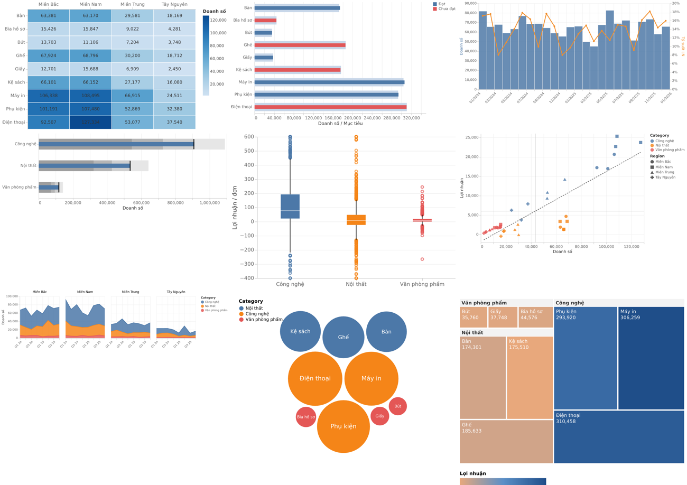

## TL;DR — nên dùng gì

| # | Phương án | Chi phí | Giống Tableau | Tương tác (tooltip, cross-filter) | Độ khó | Kết quả thử |
|---|---|---|---|---|---|---|
| 1 | **Deneb** (custom visual chính chủ trên AppSource, dùng Vega / Vega-Lite) | Miễn phí, mã nguồn mở, được Microsoft certify | ★★★★★ (Vega-Lite cùng "ngữ pháp" với Tableau, có sẵn bảng màu `tableau10`) | Có (tooltip, cross-filter, cross-highlight) | Trung bình — viết JSON | ✅ 9/9 chart render được |
| 2 | **Python visual** (có sẵn trong Power BI: matplotlib/seaborn) | Miễn phí ở Desktop; lên Service cần license Pro/PPU | ★★★★ (`tab10` của matplotlib chính là bảng màu Tableau) | **Không** — chỉ là ảnh tĩnh | Dễ nếu biết Python | ✅ 3/3 chart render được |
| 3 | **Tự viết custom visual** (`powerbi-visuals-tools` của Microsoft, TypeScript + d3) | Miễn phí, MIT | ★★★★★ — làm y hệt được | Có, đầy đủ | Khó nhất | ✅ Build ra `.pbiviz`, test headless OK |
| 4 | **Visual miễn phí trên AppSource** (Sankey, Chord, Bullet, Box & Whisker, Tornado... của Microsoft và bên thứ 3) | Miễn phí / freemium | ★★★ | Có | Dễ nhất — kéo thả | Không test được trên Linux (cần Power BI Desktop) |
| 5 | **`tools/twb_inspector.py`** — đọc `.twb/.twbx` → liệt kê sheet, mark, field, calculated field, gợi ý cách dựng lại | Miễn phí, chỉ cần Python | — | — | Dễ | ✅ test trên workbook Superstore 22 sheet thật |

**Khuyến nghị:** dùng **Deneb làm chính** (giống Tableau nhất mà vẫn tương tác), visual gốc / AppSource cho chart đơn giản,
Python visual cho chart thống kê tĩnh, và chỉ tự viết custom visual khi cần một chart dùng đi dùng lại nhiều nơi.

> Lưu ý: **Charticulator** (công cụ cũ của Microsoft) đã bị Microsoft Research ngừng hỗ trợ; hiện chỉ còn bản cộng đồng,
> nhiều người báo lỗi trên Power BI Service → **không khuyến nghị** cho báo cáo mới.
> Các tool "convert Tableau → Power BI" tự động (Pulse Convert, BIPort, Wavicle...) đều **trả phí** — chỉ có bản đánh giá/assessment miễn phí.

---

## Cấu trúc thư mục

```
tableau-to-powerbi/
├── data/superstore_sample.csv         # 4.000 dòng dữ liệu mẫu kiểu "Superstore" (tiếng Việt)
├── deneb/                             # 9 spec dán thẳng vào Deneb
│   ├── 01_highlight_table.json        #   Vega-Lite
│   ├── 02_bar_in_bar.json
│   ├── 03_dual_axis_combo.json
│   ├── 04_bullet_chart.json
│   ├── 05_box_whisker.json
│   ├── 06_scatter_quadrant.json       #   scatter + trend line + đường trung bình
│   ├── 07_trellis_area.json           #   small multiples
│   ├── 08_packed_bubbles.vega.json    #   Vega (Vega-Lite không làm được pack layout)
│   └── 09_treemap.vega.json           #   Vega
├── python-visuals/                    # script dán vào Python visual của Power BI
├── tableauBulletVisual/               # custom visual tự viết (TypeScript + d3)
│   └── dist/*.pbiviz                  #   file đã build, import thẳng vào Power BI
├── tools/
│   ├── twb_inspector.py               # đọc .twb/.twbx -> báo cáo markdown
│   ├── render_deneb_specs.py          # test spec Deneb ngoài Power BI (vl-convert)
│   ├── run_python_visuals.py          # test Python visual ngoài Power BI
│   ├── test_pbiviz_headless.js        # test .pbiviz trong Chromium headless với host giả lập
│   └── make_sample_data.py
├── tests/                             # unit test cho twb_inspector
├── examples/superstore_twbx_report.md # báo cáo mẫu khi chạy inspector trên workbook thật
└── renders/                           # ảnh kết quả thử nghiệm
```

---

## 1. Deneb (khuyến nghị)

**Cài:** Power BI Desktop → *Visualizations* → `…` → *Get more visuals* → tìm **Deneb** → *Add*.

**Dùng một template trong repo:**
1. Thêm visual Deneb vào trang, kéo các cột cần thiết vào ô **Values**
   (ví dụ highlight table: `Region`, `SubCategory`, `Sales`). Tên cột phải trùng với tên field trong spec.
2. Mở menu `…` của visual → **Edit** → chọn **Vega-Lite** (file `.json`) hoặc **Vega** (file `.vega.json`) → *Create*.
3. Xoá nội dung tab *Specification*, dán nội dung file JSON → **Apply**.
4. Spec đã có `"data": {"name": "dataset"}` — đây là tên Deneb dùng cho dữ liệu từ Power BI. Phần `config` chứa "theme Tableau"
   (palette `tableau10`, lưới nhạt, font Segoe UI) — có thể chuyển sang tab *Config* để dùng chung.

**Mẹo:**
- Các spec tự tổng hợp (`aggregate`) bên trong, nên kéo field nào vào cũng chạy. Với box plot (05) cần dữ liệu **từng dòng**:
  thêm `OrderID` vào Values hoặc chọn *Don't summarize* cho `Profit`.
- Power BI mặc định chỉ gửi tối đa ~10.000 dòng cho custom visual; Deneb có tuỳ chọn *Override row limit* trong phần Data limit.
- Bật cross-filter / tooltip của Power BI trong *Settings* của Deneb (Interactivity).
- Kho template cộng đồng: [Deneb-Vega-Templates](https://github.com/avatorl/Deneb-Vega-Templates), ví dụ Vega-Lite chính thức: <https://vega.github.io/vega-lite/examples/>.

**Kiểm thử ngoài Power BI (đã làm):** `python tools/render_deneb_specs.py` — nạp CSV mẫu vào đúng chỗ `dataset`,
render bằng Vega-Lite 5.21 / Vega 6 → `renders/*_deneb.png`. Kết quả: **9/9 spec OK**.

| Chart Tableau | File | Ảnh |
|---|---|---|
| Highlight table | `deneb/01_highlight_table.json` | 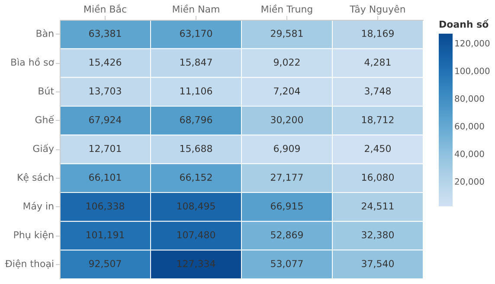 |
| Bar-in-bar (thực tế vs mục tiêu) | `deneb/02_bar_in_bar.json` | 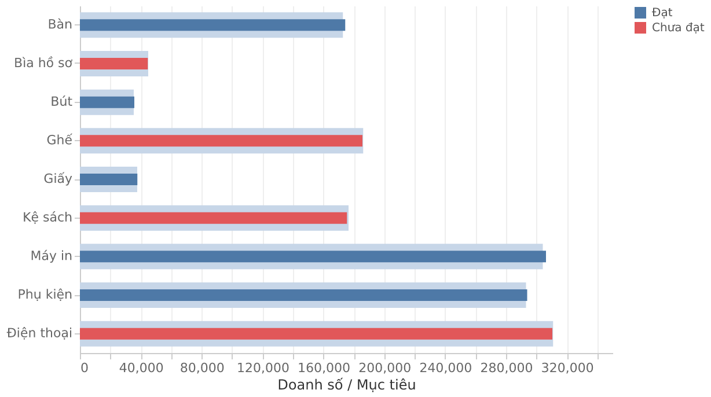 |
| Dual axis (cột + đường, 2 trục) | `deneb/03_dual_axis_combo.json` | 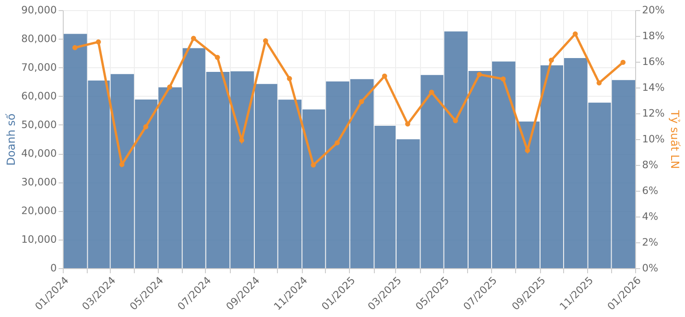 |
| Bullet graph | `deneb/04_bullet_chart.json` | 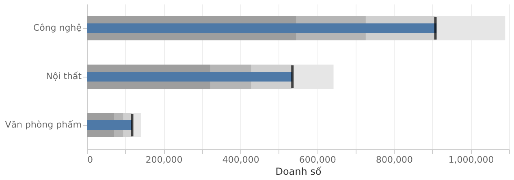 |
| Box-and-whisker | `deneb/05_box_whisker.json` | 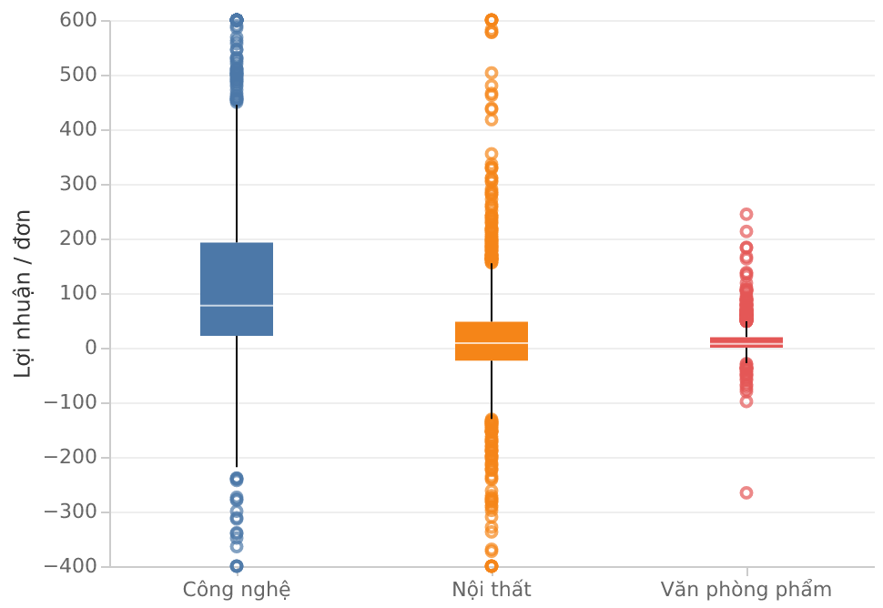 |
| Scatter + trend + quadrant | `deneb/06_scatter_quadrant.json` | 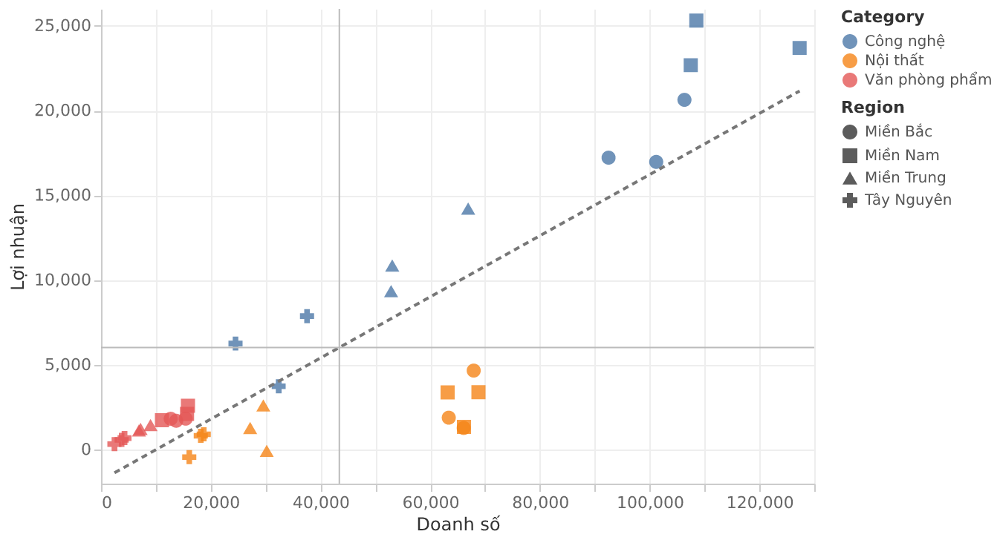 |
| Small multiples (trellis) | `deneb/07_trellis_area.json` | 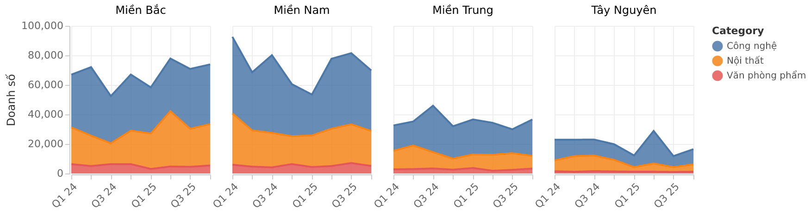 |
| Packed bubbles | `deneb/08_packed_bubbles.vega.json` | 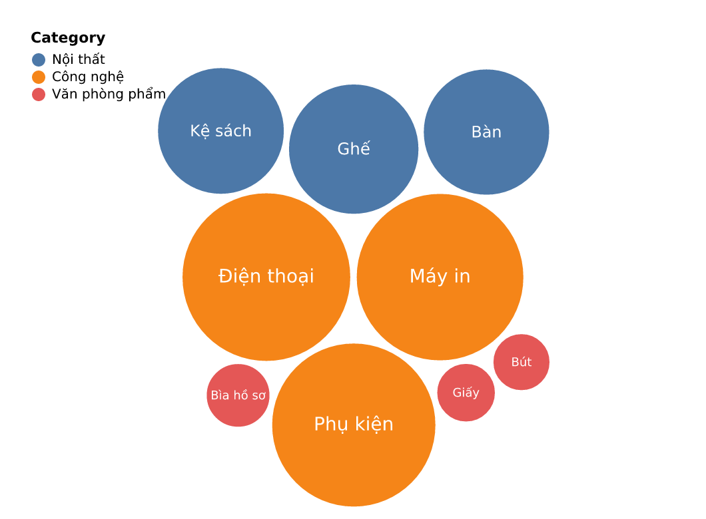 |
| Treemap 2 cấp | `deneb/09_treemap.vega.json` | 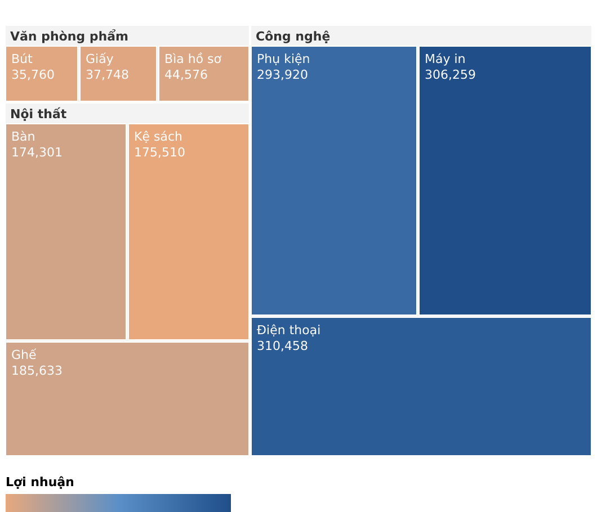 |

## 2. Python visual (có sẵn trong Power BI)

**Chuẩn bị:** cài Python + `pip install pandas matplotlib seaborn`, rồi Power BI Desktop → *File → Options → Python scripting* trỏ tới Python đó.

**Dùng:** thêm visual **Py** → kéo field vào *Values* → dán nội dung file trong `python-visuals/` vào ô script.
Power BI tự tạo biến `dataset` (pandas DataFrame, đã bỏ trùng lặp). `tableau_style.py` là đoạn "theme Tableau" có thể dán lên đầu mỗi script.

**Kiểm thử (đã làm):** `python tools/run_python_visuals.py` giả lập biến `dataset` → **3/3 OK**.

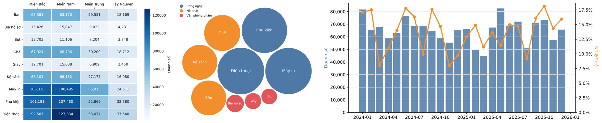

**Hạn chế:** ảnh tĩnh (không tooltip/không click lọc), giới hạn 150.000 dòng, chạy chậm hơn;
trên Power BI Service cần license Pro/PPU và chỉ hỗ trợ một danh sách package nhất định (matplotlib, seaborn, pandas... có trong danh sách).
Thay thế tương tự: **R visual** (ggplot2 + `ggthemes::scale_color_tableau()` — gói ggthemes có sẵn bảng màu Tableau).

## 3. Tự viết custom visual (`tableauBulletVisual/`)

Bộ công cụ chính thức `powerbi-visuals-tools` (miễn phí, MIT) cho phép viết visual bằng TypeScript + d3 và đóng gói thành `.pbiviz`.
Đã làm thử một **Bullet Graph kiểu Tableau**: dải tham chiếu 60/80/100/120%, thanh thực tế, vạch mục tiêu, nhãn % đạt,
tooltip, click để cross-filter các visual khác (Ctrl+click chọn nhiều), tuỳ chỉnh màu trong khung Format.

**Dùng file đã build:** Power BI → *Visualizations* → `…` → **Import a visual from a file** →
`tableauBulletVisual/dist/tableauBulletVisual…1.0.0.0.pbiviz`. Kéo `SubCategory` → *Danh mục*, `Sales` → *Thực tế*, `Target` → *Mục tiêu*.

**Tự build lại:**
```bash
npm i -g powerbi-visuals-tools
cd tableauBulletVisual && npm ci && pbiviz package     # -> dist/*.pbiviz
```

**Kiểm thử (đã làm):** `node tools/test_pbiviz_headless.js tableauBulletVisual/dist/*.pbiviz out.png` — giải nén `.pbiviz`,
chạy trong Chromium headless với host Power BI giả lập. Kết quả: 9 hàng được vẽ, tooltip hiện khi hover, click chọn 1 hàng thì
8 hàng còn lại mờ đi (opacity 0.35), không lỗi JS.

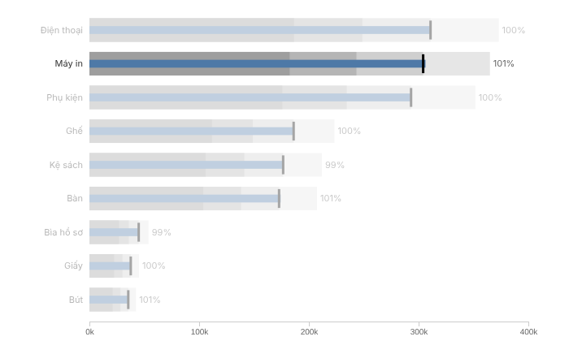

**Lưu ý:** admin tenant có thể tắt "import visual từ file"; visual chưa certify thì không export được sang PowerPoint/PDF
và email subscription. Muốn dùng rộng trong công ty thì admin đưa vào *Organizational visuals*.

## 4. Visual miễn phí trên AppSource

Tìm trong *Get more visuals*, lọc **Free**. Nên kiểm tra kỹ nhãn giá: nhiều visual là *freemium* (miễn phí trên Desktop nhưng
hiện watermark trên Service, hoặc khoá tính năng). Những visual hay dùng thay cho chart Tableau:

| Chart Tableau | Visual gốc của Power BI | Hoặc |
|---|---|---|
| Highlight table | Matrix + Conditional formatting (background color) | Deneb 01 |
| Treemap | Treemap (gốc) | Deneb 09 (2 cấp, màu theo measure khác) |
| Dual axis | Line and clustered column chart | Deneb 03 |
| Scatter + trend | Scatter (+ Analytics pane: trend line, average line) | Deneb 06 |
| Small multiples | Small multiples (gốc, ở line/bar/area) | Deneb 07 |
| Bullet | — | Deneb 04 / custom visual / các visual "Bullet chart" trên AppSource |
| Box plot | — | Deneb 05 / "Box and Whisker" trên AppSource |
| Packed bubbles | — | Deneb 08 |
| Sankey | — | "Sankey Chart" của Microsoft (miễn phí) |
| Gantt | — | Deneb (bar với `x`/`x2`) / visual Gantt trên AppSource |
| Map | Map, Filled map, Azure Maps | — |

## 5. Đọc file Tableau có sẵn mà không cần Tableau — `tools/twb_inspector.py`

`.twb` là XML, `.twbx` là file zip chứa `.twb` + dữ liệu. Script chỉ dùng thư viện chuẩn Python:

```bash
python tools/twb_inspector.py "Bao cao.twbx" -o report.md
```

Kết quả: bảng từng worksheet (mark, field trên Rows/Columns, color/size/label...), loại chart đoán được, **gợi ý dựng lại trong Power BI
(trỏ thẳng tới template Deneb tương ứng)**, cùng danh sách calculated field kèm công thức Tableau để viết lại bằng DAX.
Với `.twbx` còn liệt kê file dữ liệu đóng gói kèm (CSV/Excel giải nén ra dùng được ngay cho Power BI; `.hyper` đọc được bằng gói
miễn phí `tableauhyperapi` hoặc `pantab`).

Đã thử trên workbook Superstore thật (22 sheet, 6 dashboard) từ repo mã nguồn mở của Tableau → xem
[`examples/superstore_twbx_report.md`](examples/superstore_twbx_report.md). Nhận diện đúng: bar, scatter, Gantt, line forecast,
highlight table, map, area small multiples, crosstab. Workbook từ **Tableau Public** (miễn phí) cũng tải về dạng `.twbx` và dùng được.

Unit test: `python -m unittest tests/test_twb_inspector.py`.

**Giới hạn:** chỉ đọc *cấu trúc* — định dạng chi tiết, LOD/table calculation, parameter actions vẫn phải chuyển tay; phần "loại chart"
là heuristic, nên rà lại.

---

## Chạy lại toàn bộ thử nghiệm

```bash
pip install pandas matplotlib seaborn vl-convert-python pillow
python tools/make_sample_data.py
python tools/render_deneb_specs.py
python tools/run_python_visuals.py
python -m unittest tests/test_twb_inspector.py
# custom visual (cần Node 18+ và playwright)
npm i -g powerbi-visuals-tools playwright
(cd tableauBulletVisual && npm ci && pbiviz package)
node tools/test_pbiviz_headless.js tableauBulletVisual/dist/*.pbiviz renders/10_bullet_custom_visual_pbiviz.png
```

*Lưu ý môi trường thử:* mọi kiểm thử chạy trên Linux, ngoài Power BI (không có Power BI Desktop). Spec Deneb được render bằng đúng
engine Vega/Vega-Lite mà Deneb dùng, Python visual chạy với biến `dataset` giả lập, custom visual chạy trong Chromium với host giả lập —
nên cần mở thử trong Power BI Desktop một lần để xác nhận cuối.

## Nguồn tham khảo

- Deneb: [AppSource](https://appsource.microsoft.com/en-us/product/PowerBIVisuals/coacervolimited1596856650797.deneb) · [GitHub](https://github.com/deneb-viz/deneb) · [Template cộng đồng](https://github.com/avatorl/Deneb-Vega-Templates)
- [Power BI custom visuals (Microsoft Learn)](https://learn.microsoft.com/power-bi/developer/visuals/power-bi-custom-visuals)
- [ZoomCharts — best free Power BI custom visuals 2025](https://zoomcharts.com/en/microsoft-power-bi-custom-visuals/blog/best-free-power-bi-custom-visuals-for-data-analysis-in-2025)
- Charticulator ngừng hỗ trợ: [GitHub issue #1085](https://www.github.com/microsoft/charticulator/issues/1085) · [Fabric community](https://community.fabric.microsoft.com/t5/Custom-Visuals-Development/Charticulator-no-longer-supported-what-do-I-use-instead/td-p/4105884)
- Violin plot miễn phí: [dm-p/power-bi-visuals-violin-plot](https://bitbucket.org/dm-p/power-bi-visuals-violin-plot)
- Tool chuyển đổi trả phí: [Pulse Convert](https://appsource.microsoft.com/en-gb/product/saas/officesolution1640276900203.pulse_convert) · [Thảo luận Fabric community](https://community.fabric.microsoft.com/t5/Fabric-platform/Is-there-any-tool-available-to-migrate-Tableau-dashboards-to/td-p/4648755)
- Workbook mẫu dùng để test: [tableau/document-api-python](https://github.com/tableau/document-api-python) (MIT)
