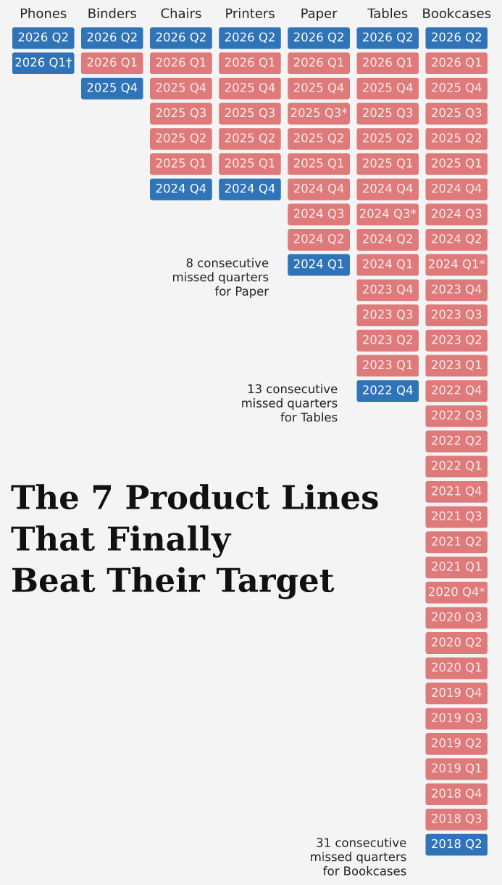
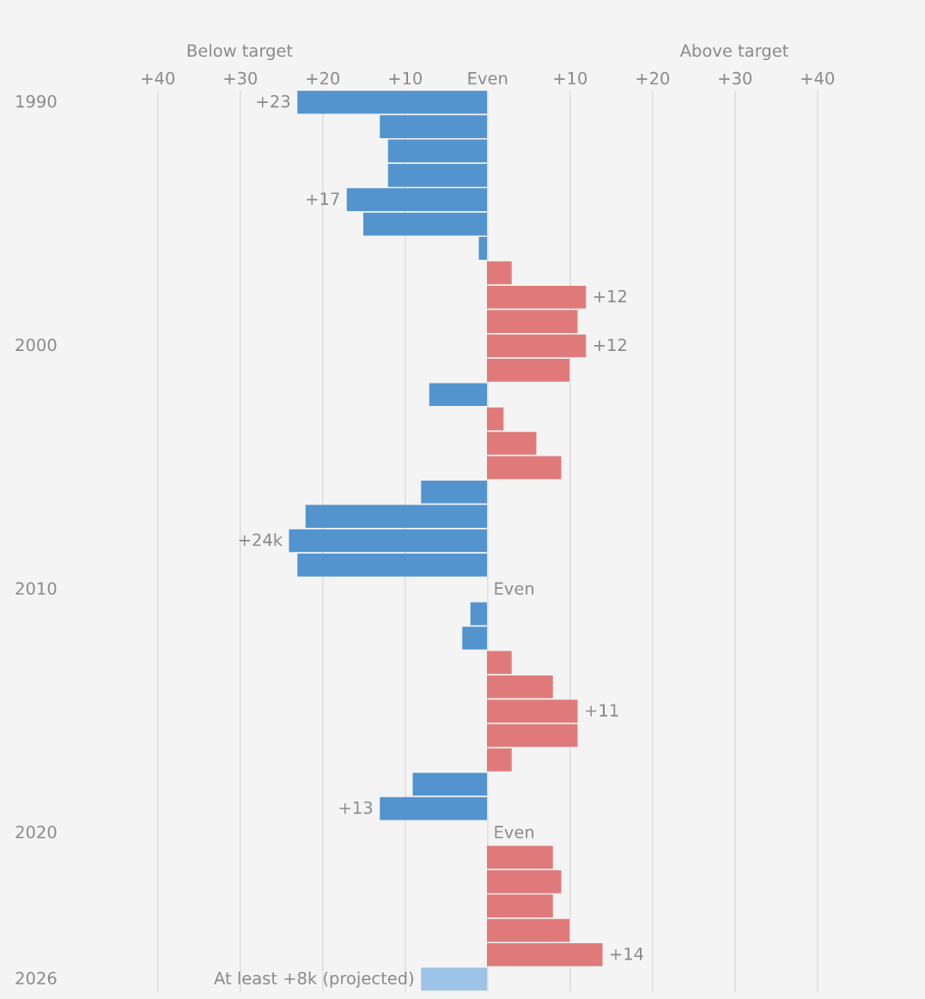
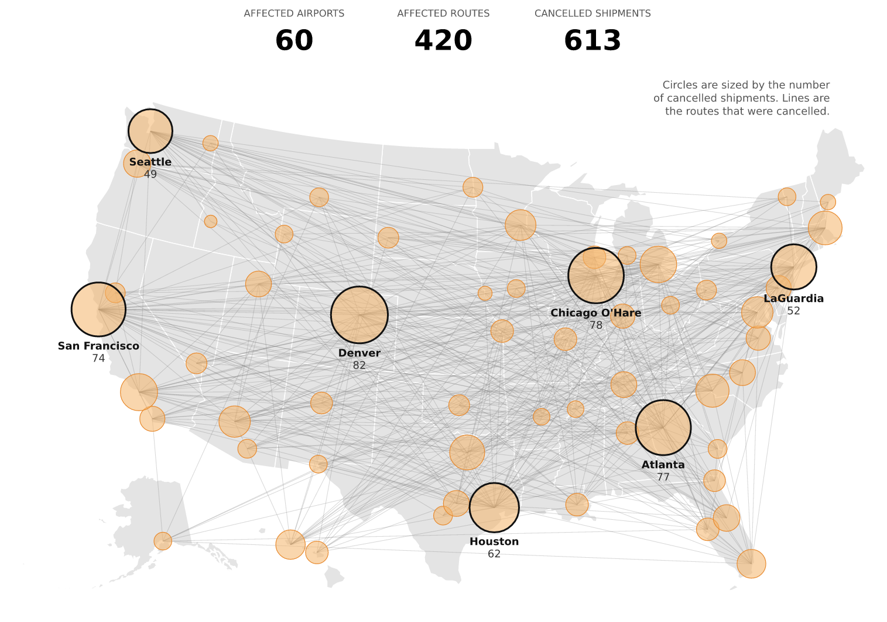
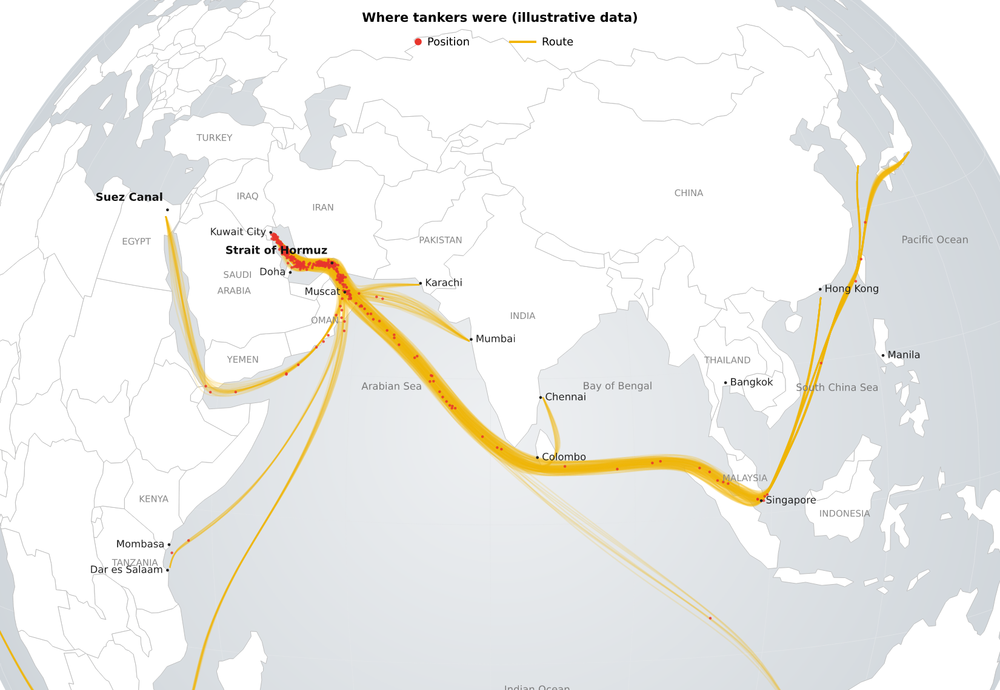

# NYT-style charts in Deneb

Four graphics in the style of New York Times charts, rebuilt as Deneb specs. All four work in Deneb.
Each one is in the sample report (`../powerbi-sample`, pages 3–5) and is also available as a standalone spec in `specs/`.

**All data here is illustrative / randomly generated** (`make_data.py`). Only the place names and coordinates are real.

| Chart | Spec | Language | Power BI fields (drop into Deneb *Values*) |
|---|---|---|---|
| Streak tiles ("periods since last win") | `specs/nyt_01_streak_tiles.json` | Vega-Lite | Product, Period, PeriodsAgo, Result, Note |
| Diverging "balance" bars | `specs/nyt_02_diverging_balance.json` | Vega-Lite | Year, Margin, Projected |
| US bubble + route map | `specs/nyt_03_us_route_map.vega.json` | Vega | Origin, OriginName, OriginLon, OriginLat, Dest, DestName, DestLon, DestLat, Cancelled |
| Globe with routes + positions | `specs/nyt_04_globe_routes.vega.json` | Vega | Kind, Id, Seq, Lane, Lon, Lat, RowId |

| | |
|---|---|
|  |  |
|  |  |

## How each one works

- **Streak tiles:** a `rect` + `text` grid, with x = column and y = "periods ago". The annotations are computed
  in the spec: the three longest streaks are found with `joinaggregate` + `dense_rank`. The serif headline is a text
  mark in the empty corner; edit or delete it.
- **Diverging bars:** a normal bar chart with a diverging x scale. Axis labels show `+N` on both sides via `labelExpr`.
  Which bars get labels is computed in the spec: zero ("Even"), the largest value, local peaks of 10 or more, and the
  projected row.
- **Route map:** Vega `albersUsa` projection, so Alaska and Hawaii are inset. Airports are built *inside* the spec
  from the route rows (origin + destination are unioned, then summed). Circle **area** is proportional to the count,
  and the 7 largest get a black ring and a label. The KPI header is computed from the same data, so it follows slicers.
- **Globe:** Vega `orthographic` projection with a radial-gradient ocean, graticule, country outlines, and ~270 routes
  drawn as smoothed lines (`interpolate: basis`) at low opacity, which makes the busy lanes glow. Red dots are
  positions. Change `centerLon` / `centerLat` in the spec to rotate the globe.

## Things to know

- **Map outlines are embedded in the spec.** Certified visuals like Deneb can't download files at runtime, so the
  TopoJSON is inlined: US states ~23 KB (us-atlas, simplified 15%), world countries ~60 KB (world-atlas 110m, simplified
  50%). This makes the map specs 33 KB and 75 KB.
- **Simplifying a world map can flip polygons.** After simplifying, Fiji (it crosses the 180° meridian) became an
  "inside-out" polygon that covered the whole globe. It was removed, along with Antarctica. Run
  `geoArea(feature) > 2π` (d3-geo) on any new map file to catch this.
- **Row limits:** Power BI sends Deneb up to 30,000 rows per load (Deneb can fetch more). The globe uses 5,724 rows.
- **Fonts:** specs use *Segoe UI* (Power BI's font) and *Georgia* for the serif headline, both of which exist on Windows.
- **Copyright:** these are original specs that copy the *chart types and styling*, not The New York Times' data,
  text or graphics. Keep it that way for anything you publish.

Rebuild: `python nyt-style/make_data.py && python nyt-style/build_specs.py`
