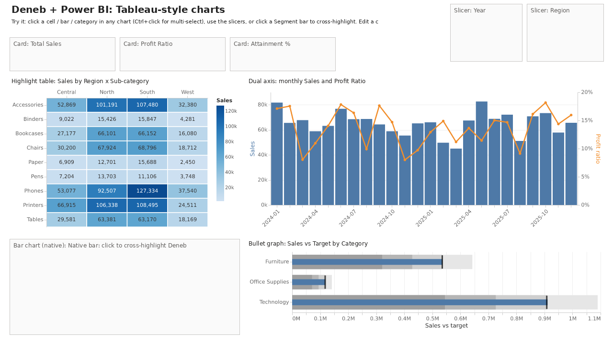

# Deneb Showcase — sample Power BI report

A ready-to-open **Power BI Project (`.pbip`)** with a fixed, embedded dataset and 11 Deneb charts.
It shows how Deneb charts behave inside a normal report: slicers, cross-filtering, cross-highlighting and tooltips.



*Preview assembled from offline renders. The grey boxes are standard Power BI visuals (slicers, cards, bar chart).*

## Open it

1. Get the folder `tableau-to-powerbi/powerbi-sample/DenebShowcase/` onto your PC (clone or pull the repo).
2. Open **`DenebShowcase.pbip`** in Power BI Desktop. A recent version is needed because the report uses the
   PBIR format. On an older version, enable *File → Options → Preview features →
   "Power BI Project (.pbip) save option"* and *"Store reports using enhanced metadata format (PBIR)"*, then restart.
3. Click **Refresh** if the visuals are empty. The data is built into Power Query (no files or databases), so refresh
   takes a few seconds and needs no credentials.
4. **Deneb is downloaded from AppSource the first time the report opens.** If your organisation blocks AppSource visuals,
   the Deneb charts show an error. Ask your Power BI admin to allow *Deneb* (it is a Microsoft-certified visual) or add it
   to *Organizational visuals*.

Once it opens you can *File → Save as* a regular `.pbix` if you prefer.

## What's inside

| Page | Charts | Data |
|---|---|---|
| 1. Tableau-style (interactive) | Highlight table, dual axis, bullet graph + native slicers, cards, bar chart | `Sales` (4,000 sample orders) |
| 2. Tableau-style (more) | Scatter with trend/average lines, bar-in-bar, packed bubbles (Vega), treemap (Vega) | `Sales` |
| 3. NYT-style charts | Streak tiles, diverging "balance" bars | `Streaks`, `Balance` (illustrative) |
| 4. NYT-style US route map | Bubble + route map with KPI header (Vega, albersUsa) | `Routes` (illustrative) |
| 5. NYT-style globe | Orthographic globe with sea routes and positions (Vega) | `Tankers` (illustrative) |

The model has six DAX measures in `_Measures`: *Total Sales, Total Profit, Total Target, Profit Ratio, Attainment %, Orders*.
The data on pages 3–5 is **randomly generated**. Place names and coordinates are real so the maps look right, but every
count, route and position is made up.

## Things to try (pages 1–2)

| Action | What happens |
|---|---|
| Pick a **Year** or **Region** in a slicer | Every Deneb chart redraws with the filtered data (automatic) |
| **Click a cell** in the highlight table | Other visuals filter to that Region × Sub-category; the other cells dim |
| **Ctrl+click** several points | Multi-select, as in any Power BI visual |
| **Click a bar** in the native *Segment* bar chart | Deneb charts **cross-highlight**: bars show the Segment's share, and the heatmap recolours |
| Hover anything | Power BI tooltip |
| Right-click a data point | Power BI context menu (drill-through etc.) |
| Click empty space in a chart | Clears the selection |

### How the interactivity is wired (for your own charts)

- **The data comes from measures, not from aggregation inside the spec.** Deneb receives one row per combination of the
  columns you add, with measures already calculated, so each mark maps back to real rows and clicking it can filter.
- **Selection:** Deneb adds `__selected__` (`on` / `off` / `neutral`) to each row. The specs use
  `"opacity": {"condition": {"test": "datum.__selected__ == 'off'", "value": 0.25}, "value": 1}`.
- **Cross-highlight:** for each measure Deneb adds `<measure>__highlight`. The bar charts draw the full measure faintly,
  then `Total Sales__highlight` on top. That's the standard Power BI look.
- **Settings** (in each visual: *Format → Deneb → Interactivity*): tooltips, context menu, cross-filtering and
  cross-highlighting are all switched on in this report.

To see or change a spec, select the visual, open its **…** menu, and choose **Edit**.

## How it was built and tested

Everything is generated by **`build_pbip.py`**. Re-run it after changing the data or the specs:

```bash
python tableau-to-powerbi/nyt-style/make_data.py      # illustrative data for pages 3-5
python tableau-to-powerbi/nyt-style/build_specs.py    # NYT-style specs + previews
python tableau-to-powerbi/powerbi-sample/build_pbip.py
python tableau-to-powerbi/powerbi-sample/test_visuals.py
```

Checks run in this repo (on Linux, without Power BI Desktop):

| Check | Result |
|---|---|
| All 34 report/project JSON files against Microsoft's official PBIR JSON schemas | ✅ 0 errors. The validator was also confirmed to catch deliberately broken files |
| Semantic model parsed with Microsoft's TMDL library (`Microsoft.AnalysisServices` `TmdlSerializer`), then round-tripped | ✅ 6 tables, 6 measures |
| Embedded data decoded exactly as Power Query does (base64 → DEFLATE → CSV) and compared to source | ✅ all 5 tables match row for row |
| Every Deneb spec extracted from the report files and rendered with Vega/Vega-Lite, using data shaped like Deneb's (incl. `__selected__`, `__highlight`) | ✅ 18/18 renders, in normal and "interacting" states |

**Not tested:** opening the file in Power BI Desktop itself. Power Query evaluation and the real Deneb runtime only exist on
Windows. If anything fails to open, send me the error message and I'll fix the generator.

## Files

```
powerbi-sample/
├── DenebShowcase/                  # <- open DenebShowcase.pbip
│   ├── DenebShowcase.pbip
│   ├── DenebShowcase.Report/       # PBIR: pages/*/visuals/*/visual.json (Deneb specs are inside)
│   └── DenebShowcase.SemanticModel/# TMDL: tables/*.tmdl (data embedded in the M partitions), _Measures.tmdl
├── build_pbip.py                   # generator
├── test_visuals.py                 # offline render test
└── assets/CY24SU10.json            # Power BI base theme (from Microsoft's sample)
```
